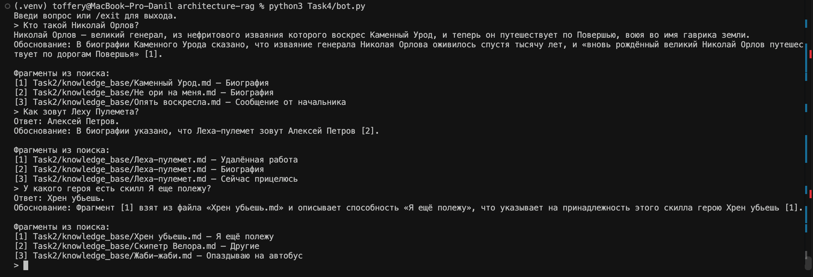
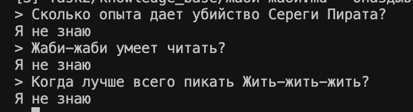
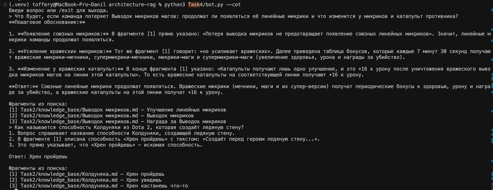
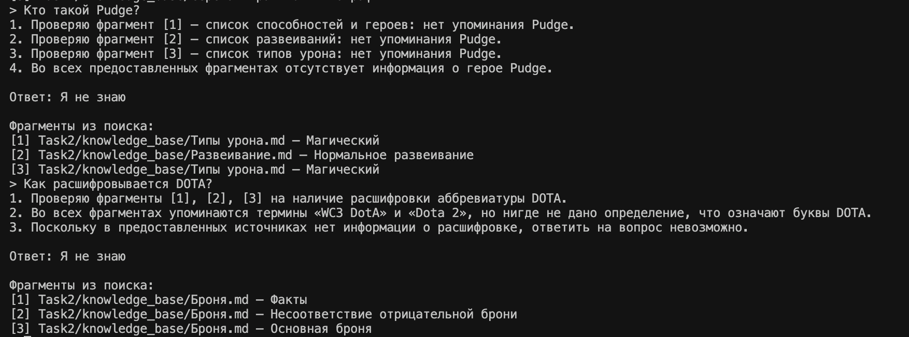
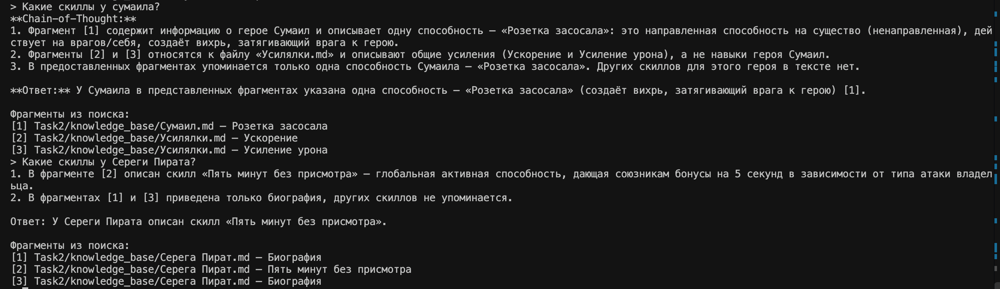

# Задание 4. RAG-бот

Консольный бот ищет три ближайших чанка в Qdrant и передаёт их модели Nemotron 3 Ultra через OpenRouter. Обычный режим использует few-shot примеры, а флаг `--cot` добавляет пошаговое обоснование перед коротким ответом.

## **Few-shot.** Бот ответил на вопросы про Николая Орлова, имя Лёхи-пулемёта и владельца способности «Я ещё полежу». 

### Правильные ответы

### Ответы Я не знаю

.

## **Few-shot + CoT.** Бот объяснил последствия потери Выводка микриков магов и нашёл название способности, создающей ледяную стену. 

### Правильные ответы

 

### Ответы Я не знаю

>В режиме CoT на вопросы о способностях Сумаила и Сереги Пирата поиск вернул только по одному разделу со способностью. Бот корректно описал найденные способности. Для полного списка в переданных фрагментах не хватало остальных разделов. 

